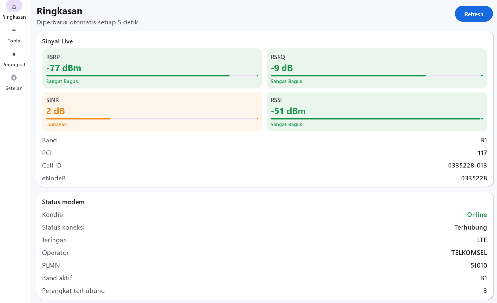
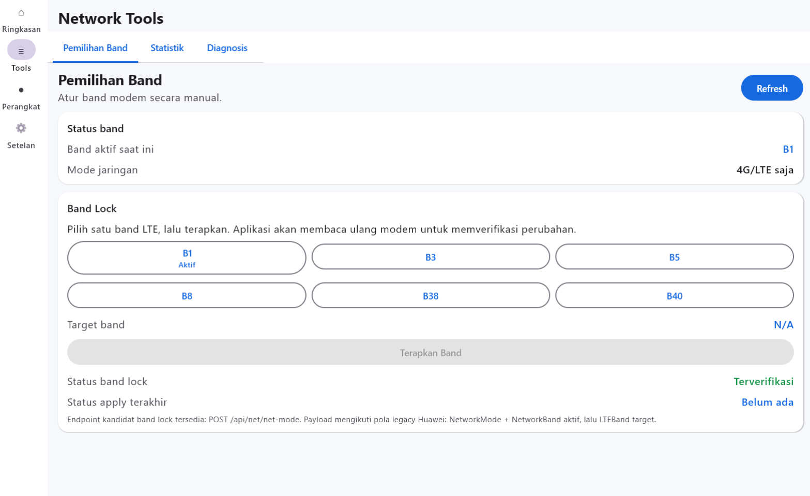
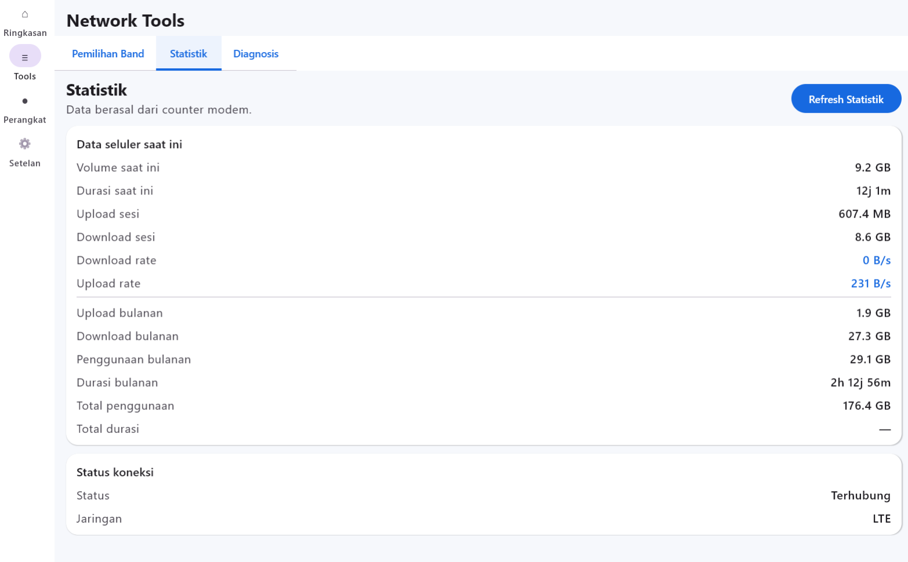

# Orbit Control

Orbit Control adalah aplikasi manajemen modem untuk Huawei B312 / Orbit Star 2 yang berkomunikasi langsung melalui Huawei HiLink API pada jaringan lokal.
Aplikasi sekarang tersedia untuk Android, Windows. Namun untuk Linux, dan iOS anda bisa compile sendiri menggunakan source code yang telah saya sediakan.

## Screenshot

<p>
  
  
  
</p>

## Download dan status platform

| Platform | Status | Distribusi |
| --- | --- | --- |
| Android | Tersedia | APK |
| Windows | Tersedia | Installer `.exe` dan `.msi` |
| Linux | Source tersedia | Perlu Build mandiri menjadi `.deb` atau `.rpm` |
| iOS/iPadOS | Source tersedia | Perlu Build melalui Xcode di macOS |

### Minimum Rekomendasi Spesifikasi

- `Android membutuhkan minimal Android 7.0 (API 24)`
- `Windows membutuhkan minimal Windows 10 x64`
- `Linux membutuhkan minimal Linux x64 dengan distro debian`.
- `iOS mendukung iPhone dan iPad, minimal iOS/iPadOS 15 atau lebih baru`

## Fitur utama

- Dashboard status modem, operator, traffic, WAN/LAN, perangkat, dan metrik sinyal.
- Band Lock LTE manual dengan konfirmasi dan verifikasi konfigurasi setelah perubahan.
- Statistik penggunaan dari counter modem.
- Diagnosis koneksi berbasis HTTP latency.
- Daftar perangkat yang terhubung.
- Informasi firmware dan status teknis modem.
- Export Debug Report tanpa menyertakan password, SessionID/token, IMEI, atau serial number.

## Cara menggunakan

1. Sambungkan perangkat ke Wi-Fi/LAN modem.
2. Jalankan Orbit Control.
3. Masukkan alamat modem. Default yang umum digunakan adalah `http://192.168.8.1`.
4. Masukkan username dan password modem.
5. Gunakan **Test Koneksi** bila diperlukan, kemudian pilih **Masuk**.
6. Gunakan menu **Ringkasan**, **Tools**, **Perangkat**, dan **Setelan** untuk mengelola modem.

Pada iOS/iPadOS, izinkan akses **Local Network** ketika sistem meminta izin agar aplikasi dapat menghubungi modem pada jaringan lokal.
Password modem tidak disimpan. Bila opsi penyimpanan konfigurasi digunakan, aplikasi hanya menyimpan host dan username.

## Source code

Repository ini menggunakan struktur berikut:

```text
OrbitControl/
├── android/     # Android — Kotlin + Jetpack Compose
├── windows/     # Windows — Kotlin + Compose Desktop
├── linux/       # Linux — Kotlin + Compose Desktop
├── ios/         # iOS/iPadOS — Swift + SwiftUI
├── screenshot/  # Dokumentasi tampilan aplikasi
├── CHANGELOG.md
└── README.md
